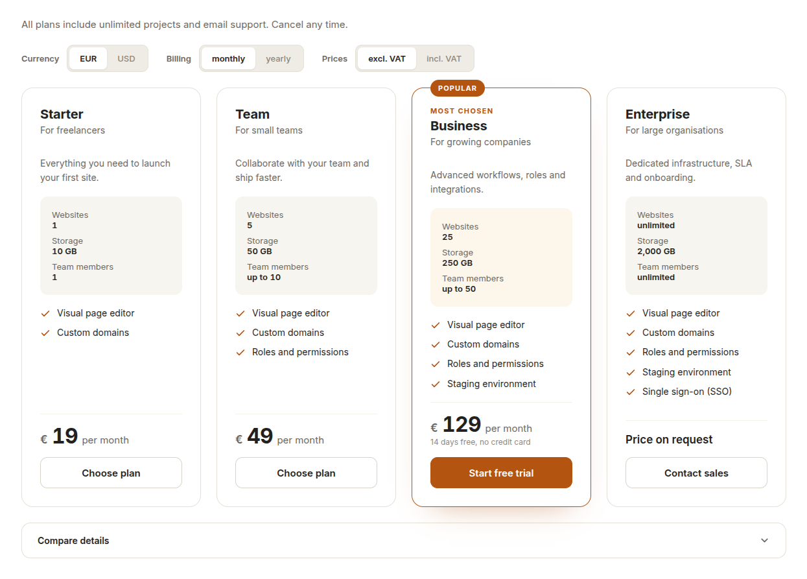
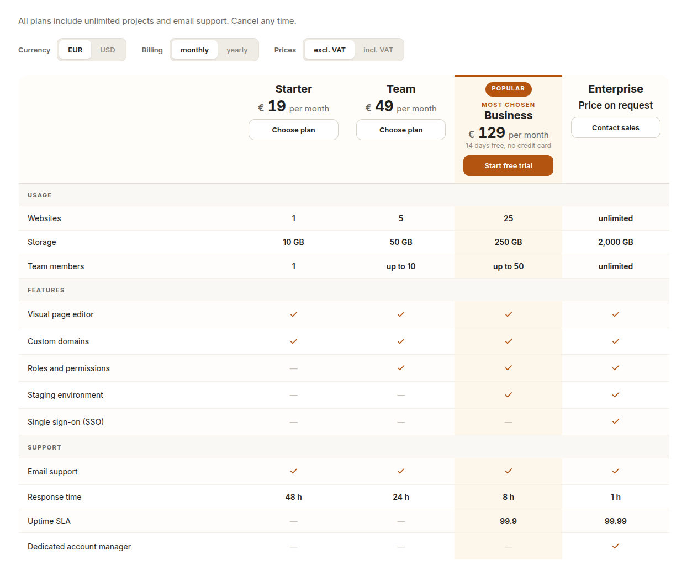
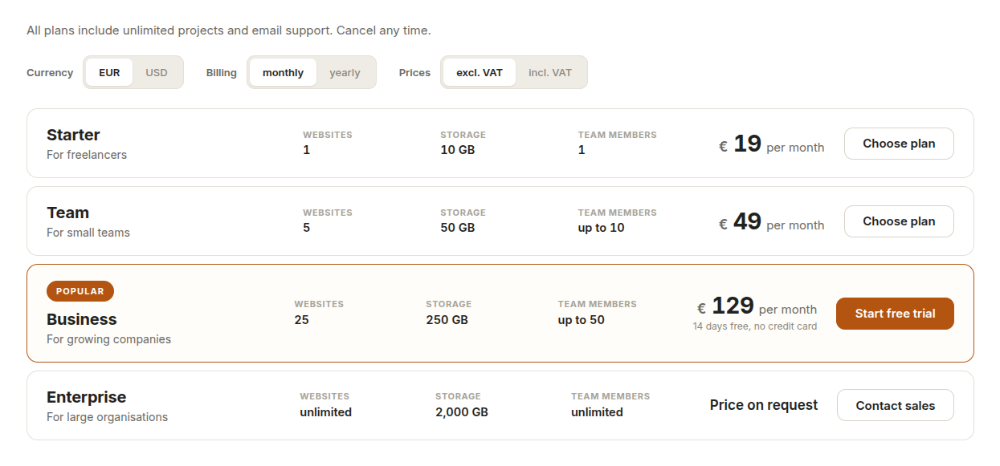

# Pricing tables for TYPO3

Plan cards, a comparison table and compact rows — all from one record. Editors
maintain plans, prices and features once; the content element decides how they
are shown. Visitors switch currency, billing period and net/gross prices right
in the browser, without a page reload and without breaking the page cache.



## Features

- **Five layouts, one data model** — plan cards, comparison table, cards with
  feature groups, compact rows, cards with expandable details. The comparison
  table can be attached below any layout, open or collapsed.
- **Switches without reload** — currency, billing period, net/gross. Each
  switch only appears when there is something to choose.
- **Prices per currency**, not converted. Net is converted to gross with the
  tax rate of the table.
- **Highlighted plan** with accent border, tinted column and optional badge.
- **No dead buttons** — a plan without a link gets no button.
- **Currency symbol before or after the amount**, number format per site
  language.
- **Responsive by container width** — four plans wrap two by two, five three
  plus two.
- **Accessible** — real table markup with scopes, screen-reader texts, buttons
  with `aria-pressed`, sticky feature column on phones.
- **Easy to brand** — all colours, radii and spacing are CSS custom properties.
- **Translated** into 37 European languages; all records are translatable.

| Comparison table | Compact rows |
|---|---|
|  |  |

## Installation

```
composer require wapplersystems/t3-pricing
vendor/bin/typo3 extension:setup -e pricing
```

Then add the site set `wapplersystems/pricing` to your site's dependencies.
It brings the template paths, the stylesheet and the script.

## Brand colours

```css
body .ws-pricing {
    --ws-pricing-accent: #0f5e6e;
    --ws-pricing-accent-soft: #e7f0f1;
    --ws-pricing-radius: 10px;
}
```

## Documentation

Full documentation for editors and integrators: see
[`Documentation/`](Documentation/Index.rst), rendered on
[docs.typo3.org](https://docs.typo3.org/p/wapplersystems/t3-pricing/main/en-us/).

## Requirements

TYPO3 14, PHP 8.2+. The PHP extension `intl` is recommended for locale-aware
number formats.

## License

GPL-2.0-or-later, see [LICENSE](LICENSE).
